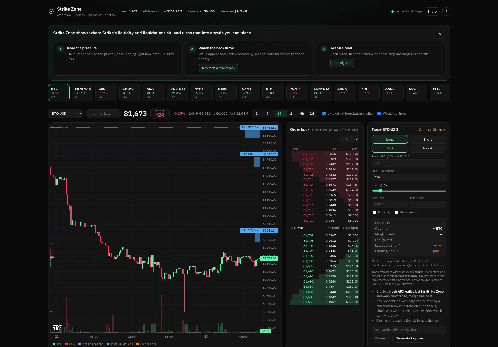

# ⚡ Strike Zone

**See the market the way a market maker does.** Strike Zone is a live order-flow, liquidity and risk visualizer for [Strike Finance](https://strikefinance.org) perpetuals, with a built-in order ticket that trades on Strike through API wallets.

**Live demo:** https://strike-zone-nine.vercel.app

Built solo for the Strike Hackathon (Oct 21–23, 2026).



## The 30-second version

1. **Read the pressure.** The number beside the price says who is leaning right now (book, flow, nearby liquidations, funding), from −100 to +100.
2. **Watch the book move.** Hit **▶ Watch a real replay** to play back a recorded session of Strike's real order book, second by second: walls appear, get pulled or absorbed, and forced liquidations sit nearby.
3. **Act on a read.** Each Trader-brief signal fills the order ticket with side, entry, stop and target in one click, with a full risk preview before anything is sent.

---

## Why

Strike V2 is a full CLOB with a public API, but traders still navigate it with a price chart and a guess. The information that actually moves perps (where liquidity rests, where leveraged traders get liquidated, who is paying funding, what whales are holding) is spread across a dozen endpoints. Strike Zone puts all of it on one screen, aligned to price, and turns it into plain-language reads a trader can act on.

## What it does

| Feature | What a trader gets | Strike data used |
|---|---|---|
| **Pressure score** | One number from −100 to +100 per market: book imbalance (40), 15-min taker flow (30), liquidation pull (20), crowded funding as a contrarian tilt (10). Big in the header with a breakdown on hover, and on every market in the strip so you can see where the action is at a glance. | depth, trades, `premiumIndex`, liquidation map for the 12 most active markets |
| **Signal → ticket** | Every actionable Trader-brief card has buttons ("Long toward 87,024 shorts", "Bid above support") that load side, entry, a 1.5×ATR stop and a target into the order ticket in one click, with the full risk preview. | brief + ticket |
| **Alerts** | Browser notifications and a webhook when price nears a liquidation cluster, funding flips, a whale nears liquidation, or pressure goes extreme. The webhook feeds Telegram/Discord bots ([ALERTS.md](ALERTS.md)). | live state + stats |
| **Replay** | A recorded case study of Strike's real book loads instantly on first visit (captured with `tools/recorder.ts`). After that, scrub or play back up to 30 minutes of the 1-second heatmap your own tab recorded. | recorded `depth` + `trade` stream |
| **Track record** | We measure the pressure score instead of asserting it: a backtest of the parts Strike has history for, plus a live log of the full score scored 15 minutes later. Results are shown in the app, good or bad. | `tools/backtest.ts`, `tools/recorder.ts` |
| **Liquidity + liquidation map on the chart** | Candles with two price-aligned profiles: resting order-book depth (left) and the liquidation map (right; orange = long liquidations below, blue = short liquidations above). Whale liquidation levels drawn as dashed lines. | `/price/v2/klines`, `kline_*` WS, `/price/v2/depth`, `depth` WS, `/stat/v1/stats/coin/liquidation-map`, `/stat/v1/stats/live-positions` |
| **Order-flow heatmap** | Bookmap-style view: every column is one second of Strike's live book; brightness = resting USD; taker trades as bubbles; mid-price line; hover readout. Spot spoofing, pulled walls and absorption. | `depth` + `trade` WebSocket |
| **Trader brief** | 11 auto-generated signals with a bullish/bearish gauge: book imbalance, support/resistance walls, execution cost, liquidation magnets, funding and cross-venue carry, mark-index basis, 15-min taker delta, OI vs price, crowd vs top-trader positioning, whale liquidation risk, ATR-based stop and leverage guidance. | all of the above + `/stat/v1/stats/coin/history/*`, `markprice` WS |
| **Derivatives panel** | Mark, index, basis, hourly funding, APR, countdown to next funding, OI in USD, long/short ratios, 7-day funding, OI and spread sparklines. | `/price/v2/premiumIndex`, `/price/v2/openInterest`, `/stat/v1/stats/coin/history/{funding,open-interest,long-short-ratio,top-trader-long-short-ratio,spread}` |
| **Order book + tape** | Live L2 ladder with grouping and cumulative depth; click a level to load it into the ticket. Trade tape with size filter and 5-minute buy/sell flow bar. | `/price/v2/depth`, `/price/v2/trades`, WS |
| **Order ticket with pre-trade risk** | Long/short, limit/market, leverage, SL/TP, post-only, reduce-only. Before you send: estimated fill and slippage from the live book, margin, maker/taker fee, estimated liquidation price, hourly funding you pay or receive, risk at stop as % of equity, R-multiple, plus warnings (liquidation inside 2×ATR, stop beyond liquidation, liquidation cluster between entry and liq, thin book). | Signed `/v2/leverage`, `/v2/order`, `/v2/openOrders`, `/v2/order/cancel`, `/v2/account` |
| **Wallet lens** | **Connect Cardano wallet** (CIP-30: Eternl, Lace, Nami, Yoroi, Typhon, Vespr…) or paste any Cardano, EVM or Solana address: equity, available margin, margin ratio and a health meter, every position with distance to liquidation, net funding, realized PnL and volume. The selected market's entry and liquidation are drawn on the chart. | `/v2/account`, `/v2/positions`, `/v2/portfolio`, `/v2/openOrders` by `blockchain_address` |
| **Discover** | Largest live positions per market, leaderboard (24h/7d/30d/all), copy-trader discovery with copy score and 30-day equity curve, and vaults (APR, Sharpe, depositors). Click any trader to open them in the wallet lens. | `/stat/v1/stats/leaderboard`, `/v2/copy/discover`, `/v2/vaults` |
| **Funding arbitrage scanner** | Strike's funding vs Binance, Bybit, OKX, Hyperliquid, Lighter and others for every market. Enter a size and holding period: it picks the best hedge venue and ranks by net carry after taker fees on both legs, with break-even days. | `/stat/v1/stats/coin/funding-rate-comparison` |
| **Market strip + platform stats** | All 30+ Strike markets (crypto, equities, commodities) with live 24h change; protocol users, volume, liquidations and revenue. | `!miniticker@arr` WS, `/price/v2/ticker/24hr`, `/stat/v1/dashboard/summary` |

## Does the pressure score work?

We tested it. On 12,373 samples (12 most active markets, 15-minute candles, about 15 days), the **taker-flow and funding parts** called the next hour's direction 45–51% of the time, against a 48% base rate for price rising. That's no edge on their own, and we say so in the app: pressure is a **read of positioning, not a forecast**. The **book-imbalance and liquidation parts** have no public history on Strike, so `tools/recorder.ts` logs the full score live every minute and the app shows the running hit rate. Reproduce with:

```bash
npx esbuild tools/backtest.ts --bundle --platform=node --format=esm --outfile=/tmp/bt.mjs && node /tmp/bt.mjs
```

## How to read it

- **Green / red**: bids and buyers / asks and sellers. **Violet**: long liquidations (below price, forced sells). **Sky blue**: short liquidations (above price, forced buys). **Gold**: your own position (white is the mid price on the heatmap).
- **Chart edges**: left is resting liquidity, right is the liquidation map. Price tends to get pulled toward the bigger liquidation pool.
- **Heatmap**: bright bands are big resting orders. A band that disappears as price approaches it was likely a spoof; a band that holds while bubbles hit it is absorption.
- **Pressure** above +15 means buyers are leaning in, below −15 sellers. Hover for its parts. It describes the crowd, it doesn't predict price (see above).
- Press **?** in the app for the full legend.

**Keyboard:** `1`–`6` timeframe · `J`/`K` next/previous market · `B`/`S` long/short · `R` heatmap replay · `L` liquidity profile · `W` whale lines · `/` filter markets · `?` help.

**Reliability:** a live/stale indicator with "updated Xs ago", a warning banner when the feed goes quiet, and a demo mode that falls back to the last snapshot (or a bundled one for the top markets) if Strike's API is unreachable, then resumes live automatically. **Share** copies a link to the exact view (market, timeframe, heatmap range, wallet). On phones the ticket becomes a bottom sheet.

## Trading safely

The ticket uses Strike **API wallets** (Ed25519). API wallets can place and cancel orders but **cannot withdraw funds**. The private key is held only in the tab's memory, never stored or sent; every request is signed in the browser exactly as specified in Strike's docs (`METHOD:PATH:TIMESTAMP:NONCE:SHA256(body)`). You can generate a key pair in the app and register the public key at app.strikefinance.org/api-keys.

Use a **fresh API wallet just for Strike Zone** and keep only trading margin behind it: any key held in a web page can be read by a malicious browser extension or a site bug, which is why the app only accepts API wallets that can't withdraw. Reloading the tab forgets the key. Cardano wallet connect is read-only: it shares your address and never signs.

## Run it

```bash
npm install
npm run dev     # http://localhost:5173
npm run build   # static site in dist/
```

No backend and no API keys needed for market data: everything reads Strike's public, CORS-enabled mainnet API (`api.strikefinance.org`) and WebSocket (`/ws/price`) directly.

## Stack

React 18, TypeScript, Vite, TradingView lightweight-charts, Canvas 2D for the heatmap and profiles, @noble/ed25519 for signing.

## Notes

- Liquidation price in the ticket is an isolated-margin estimate at the 0.5% tier-1 maintenance rate; cross margin uses the whole balance.
- Funding: Strike pays hourly; the scanner compares 8-hour-equivalent rates as Strike's stats API publishes them.
- Signals are heuristics, not financial advice.
- Strike does not publish historical order books, so live replay covers what the open tab has recorded (up to 30 minutes); the case study is a session we recorded ourselves with `tools/recorder.ts`.
- Browser alerts run while the tab is open; for always-on alerts, point the webhook at a bot backend ([ALERTS.md](ALERTS.md)).

## Roadmap

Server-side alerts with a Telegram/Discord bot anyone can join, an always-on recorder so replay covers any past period, L3 per-order view (queue position, order lifetime), builder-code routing, multi-market watchlists, a light theme and a color-blind palette.

MIT License.
